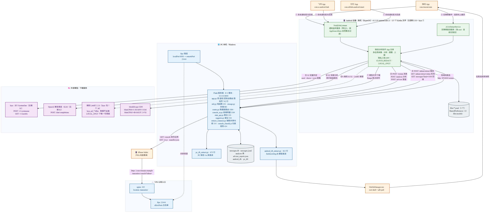
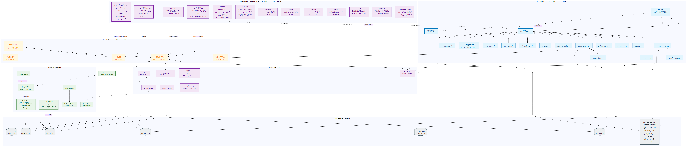
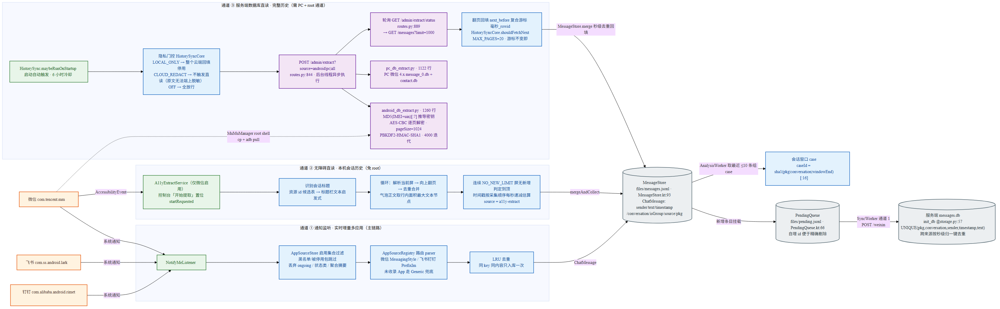
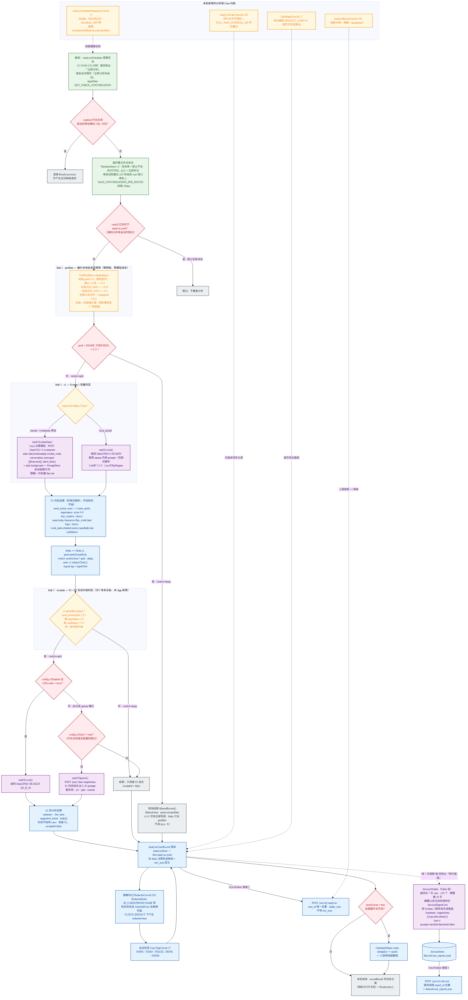
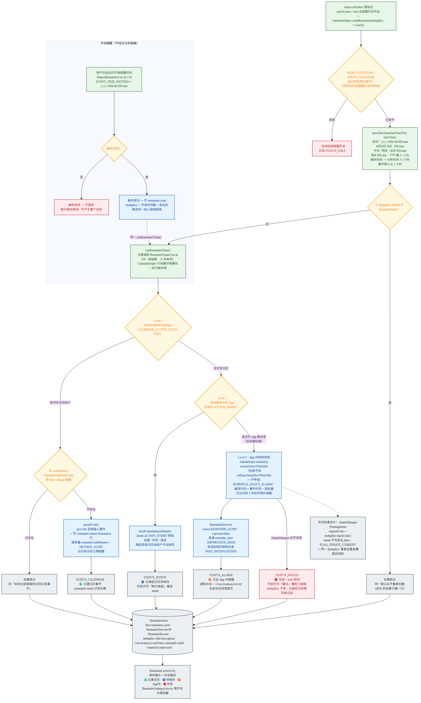
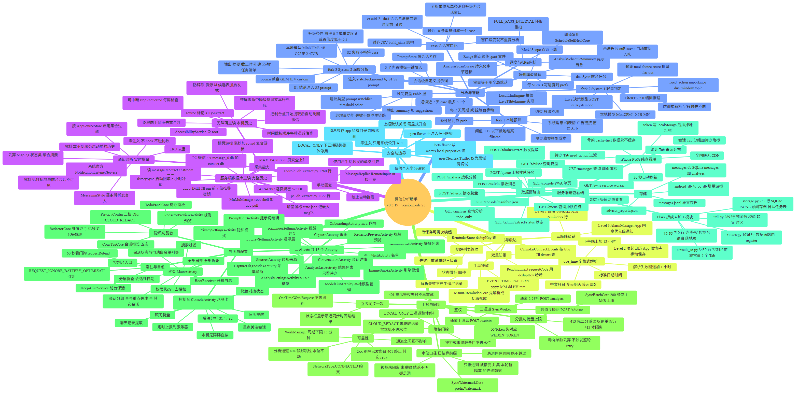
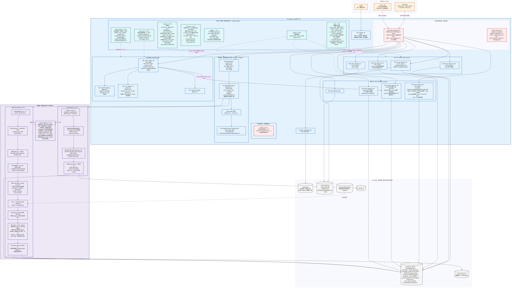
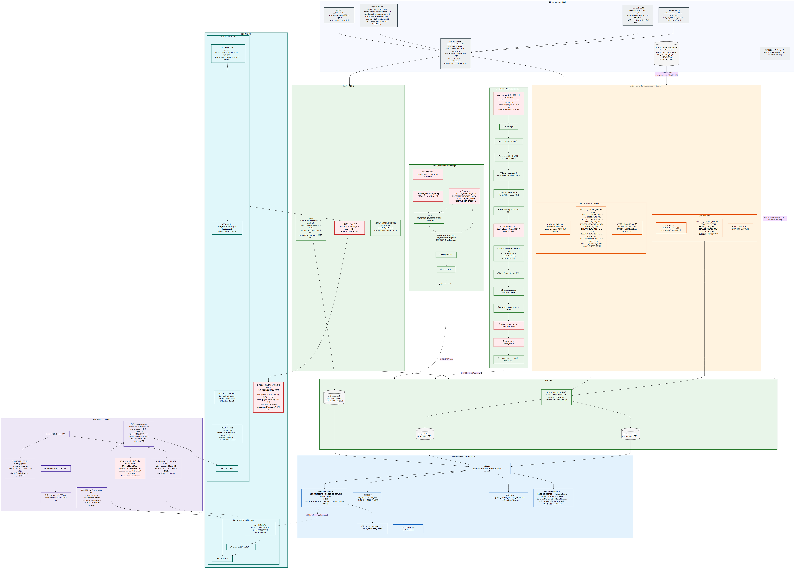
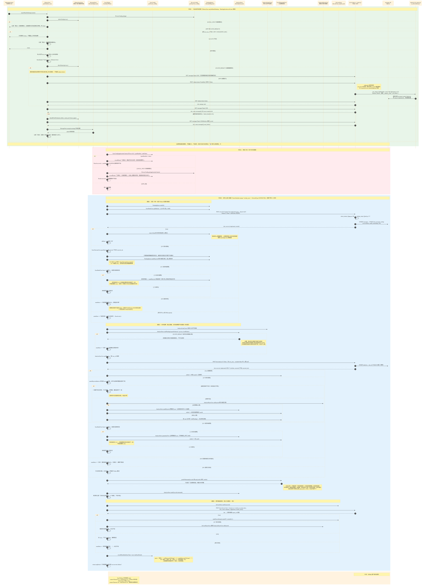

# 架构与功能图集

> 本目录是对 notifyme Android 端（`app/src/main/java/com/notifyme/android/`）**现有代码**的逆向梳理成果，不是设计提案。
> 所有节点、类名、方法名、常量、行号、路径均来自实际源码与配置文件。
>
> - 绘制方式：Mermaid 源文件（`diagrams/*.mmd`）→ `@mermaid-js/mermaid-cli@11.17.0` 光栅化
> - 每张图三份产物：`.mmd`（可编辑源）· `.png`（原生分辨率，14px 中文字体）· `.svg`（无限缩放，浏览器打开）
> - 中文字体：`Microsoft YaHei, PingFang SC, sans-serif`（Windows 由 `msyh.ttc` 提供）
> - 代码基线：**9 张图全部已重画到当前代码基线**（`versionName 0.3.19` / `versionCode 25` · Kotlin `2.2.21` · AGP `8.5.2` · Gradle `8.9` · compileSdk/targetSdk `34` · minSdk `26` · JDK `17`）——Android 端 `app/src/main/java/com/notifyme/android/` **92 个顶层 .kt**（另含 `laya/` 子包 7 个，全树 99 个，`app/src/test` 47 个），服务端已拆成 **5+1 模块**（`app.py` 711 行 / `util.py` 290 / `storage.py` 759 / `routes.py` 1037 / `console_ui.py` 3218 + `console_classify.js` 435），CI `.github/workflows/android.yml` 共 **14 步**

---

## 图集索引

| # | 图 | 回答的问题 | 尺寸 (px) |
|---|---|---|---|
| 01 | [系统上下文](#01-系统上下文) | 这个系统和谁说话？数据往哪流？ | 3970 × 1656 |
| 02 | [Android 分层架构](#02-android-分层架构) | 92 个顶层 Kotlin 文件各自属于哪一层？ | 6856 × 1986 |
| 03 | [三条采集通道](#03-三条采集通道) | 消息是怎么进来的？为什么需要三条路？ | 3386 × 1048 |
| 04 | [分析决策流水线](#04-分析决策流水线) | 一条消息如何变成一条待办？ | 2510 × 5315 |
| 05 | [三级降级提醒链](#05-三级降级提醒链) | 提醒为什么不会丢？ | 1954 × 3185 |
| 06 | [功能全景脑图](#06-功能全景脑图) | 这个 App 到底有哪些功能？ | 3135 × 1556 |
| 07 | [服务端架构](#07-服务端架构) | 服务端 5+1 模块里各装了什么？路由在哪一行？ | 6473 × 3492 |
| 08 | [构建与部署](#08-构建与部署) | 从源码到手机、从手机到公网的完整链路 | 6850 × 4895 |
| 09 | [同步时序](#09-同步时序) | 冷启动回填与三通道上报的精确行为 | 5769 × 7926 |

> 尺寸为本次重渲染后 `.png` 的**实际像素**（`System.Drawing.Image.Width × Height`），与 `diagrams/*.png` 一一对应。
>
> 重渲命令（mermaid-cli 11.17.0）：`mmdc -i diagrams/X.mmd -o diagrams/X.svg`；`mmdc -i diagrams/X.mmd -o diagrams/X.png -w <SVG viewBox 宽 + 20> -H <SVG viewBox 高 + 60>`（脑图 06 的 viewBox 起点不是 0，单独用 `-w 3200 -H 1600`）。改完 `.mmd` 必须重渲并回写本表尺寸。

---

## 01 系统上下文

四个信任域 + 两个外部服务。核心事实：**Android 端只负责"看见"和"上报"，所有重活（数据库解密直读）都在 PC 宿主机执行**，因为模拟器才有 MuMu root 通道。



- 📱 **Android 设备 / 真机（HyperOS）** — `NotifyMeListener`（通知监听，零注入，按 AppSourceStore 启用集合过滤）+ `A11yExtractService`（无障碍直读，免 root，目前仅微信）+ App 主体 + 私有目录存储
- 💻 **PC 本机 Windows** — `server/app.py` Flask `0.0.0.0:8000`、`android_db_extract.py`、`pc_db_extract.py`、`messages.db`、frpc 隧道（localPort 8000 → remotePort 23444）
- ☁️ **VPS 公网入口** — nginx `:443` `location /mmonitor/` → frps `:23444`（allowPorts 白名单）
- 🧠 **外部模型** — laya/JEV `POST /v1/systemone`、OpenAI 兼容通道 `POST /chat/completions`、ModelScope CDN（MiniCPM4-0.5B-MNN 311MB / MiniCPM3-4B-GGUF 2.47GB）
- 📱 **iPhone Safari** — PWA 纯查看端。iOS 没有 NotificationListenerService 等价物，不能采集，只能看

七条编号链路（① 系统通知官方回调 → ⑦ 模型文件下载）在图中逐条标注。

---

## 02 Android 分层架构

五层 + Application 入口。**刻意不引 Compose**：全部传统 View + RecyclerView，运行时依赖只有 5 个（core-ktx / recyclerview / work-runtime-ktx / okhttp / **litert-api**——`com.google.ai.edge.litert:litert:2.2.0`，端侧 LiteRT 推理用），把首次构建失败风险降到最低。JSON 用平台内置 `org.json`，不引 Gson/Moshi。

源码规模：`app/src/main/java/com/notifyme/android/` **顶层 92 个 .kt** + `laya/` 子包 7 个（LiteRT 移植）= 全树 99 个；`app/src/test` 47 个 .kt（纯 JVM 单测）。



| 层 | 内容 |
|---|---|
| ① UI 层 | **18 个 Activity**：Main（首页）· Console（控制台 8 卡）· Conversation（会话详情+分析面板）· AnalysisList · **AnalysisSettings（S1/S2 槽位）** · Watchlist · Sources（通知来源）· ReminderList · **ReminderSettings** · PromptEdit · ModelList · Onboarding · **Capture** · **CaptureDiagnostics** · **EngineSmoke** · **OverlaySettings** · **PrivacySettings** · **RedactorPreview** |
| ② 采集与常驻层 | `NotifyMeListener`（通知监听）· `A11yExtractService`（无障碍直读，仅微信）· `KeepAliveService`（60s 看门狗 requestRebind）· `BootReceiver` · `ReminderReceiver` · **`OverlayService`**（悬浮窗）· **`OverlayActionReceiver`** |
| ③ 后台任务层 | 4 个 Worker：Sync（三通道上报）· Analysis（逐会话窗口 case）· Advisor（近 7 天复盘）· ModelDownload（.part 断点续传）；3 个 Scheduler 全部 `enqueueUniquePeriodicWork` + UPDATE 策略 |
| ④ 领域 / 决策层 | 既有内核：`AnalysisCase` · `ForkPrefilter` · `CalendarHelper` · `AlarmHelper` · `MessageReplier` · `HistorySync` · `LocalLlmEngine` / `LayaTfliteEngine`；**本轮新增 15 个 Core 逻辑内核**（见下表） |
| ⑤ 存储层 | 5 个 JSONL + `files/models/` 目录 + **19 个** SharedPreferences 文件（见下方存储清单） |

**④ 层本轮新增的 15 个 Core 逻辑内核**（纯 Kotlin、无 Android 依赖，因此能进纯 JVM 单测；图中按主题分组，括号内为文件行数）

| 主题 | 类 | 职责 |
|---|---|---|
| 同步与上报 | `SyncOutcome`（192）· `SyncBatchCore`（84）· `SyncWatermarkCore`（57）· `AnalysisSyncCore`（60）· `AdvisorSyncCore`（44）· `HistorySyncCore`（62） | 上报结果分类（207 先于 2xx 判定）· 分批与二分 · **已结算前缀水位** · 各通道分批 · 历史同步隐私门控与翻页判定 |
| 拒绝与隔离 | `AnalysisRejectCore`（238）· `AdvisorRejectCore`（213）· `PendingRejectCore`（66） | 被拒次数累计 + 超限隔离，顾问通道复用分析通道实现 |
| 扫描与调度 | `AnalysisScanCursor`（265）· `AnalysisScheduleSummaryCore`（71） | 持久化字节游标 + 环形重扫 · 调度健康（Health）自愈阈值 |
| 脱敏与标签 | `RedactorCore`（250）· `ConvTagCore`（47） | 身份证/手机号/姓名等规则脱敏 · 会话标签 NONE/TODO/TRACK/DONE/NOISE |
| 交互与面板 | `ManualReminderCore`（117）· `TodoPanelCore`（27） | 手动提醒**先解析成功再落库** · 待办面板（DEFAULT_LIMIT=8）与首页联动 |

**本地存储全清单**

```
files/messages.jsonl            MessageStore.kt:93       采集到的消息
files/pending.jsonl             PendingQueue.kt:63       待上报队列（自增 id 精确剔除）
files/analysis.jsonl            AnalysisStore.kt:270     case 分析记录 + forks 决策轨迹
files/reminders.jsonl           ReminderStore.kt:98      提醒记录
files/advisor_reports.jsonl     AdvisorStore.kt:125     顾问复盘报告
files/models/{modelId}/         LocalModelStore.kt:31    端侧模型文件 + .part 续传

prefs analysis_config           AnalysisConfig.kt:27     分析预设/槽位/协议/Basic 账号
prefs analysis_sync             AnalysisStore.kt:273     分析上报水位（已结算前缀）
prefs sync_config               SyncConfig.kt:21         服务器地址/令牌/周期
prefs privacy_config            PrivacyConfig.kt:55      隐私模式 OFF / CLOUD_REDACT / LOCAL_ONLY
prefs prompt_config             PromptStore.kt:21        会话级自定义提示词
prefs watchlist                 WatchlistStore.kt:30     重点关注名单（v3 默认空=不关注；SENTINEL_ALL=全部关注）
prefs history_sync              HistorySync.kt:40        自动提取开关/冷却/状态
prefs a11y_extract              A11yExtractStore.kt:19   无障碍提取运行态
prefs advisor_store             AdvisorStore.kt:128      顾问上报水位
prefs app_sources               AppSourceStore.kt:36     通知来源启用集合
prefs conv_analysis_schedule    ConvAnalysisScheduleStore.kt:22  会话级分析排期
prefs conv_tags                 ConvTagStore.kt:19       会话标签
prefs keepalive_state           KeepAliveService.kt:42   保活状态
prefs local_model_store         LocalModelStore.kt:31    模型清单与下载进度
prefs collapse_state            MainActivity.kt:1503     首页折叠状态
prefs app_state                 OnboardingActivity.kt:32 向导完成标记
prefs overlay_config            OverlayConfig.kt:32      悬浮层配置
prefs pending_queue             PendingQueue.kt:66       待上报队列计数
prefs retention_state           Retention.kt:25           保留期清理状态
```

全部落在 app 私有目录，**卸载即删**。

---

## 03 三条采集通道

三条通道不是冗余，是三种能力边界互补。横向读图。



| 通道 | 机制 | 覆盖范围 | 代价 / 限制 |
|---|---|---|---|
| ① 通知监听（主链路） | 官方 `NotificationListenerService`，按 `AppSourceStore` 启用集合过滤（默认全收，黑名单/被停用包跳过），丢弃 ongoing/聚合摘要，`EXTRA_MESSAGES` 逐条解析发言人，LRU 去重 | 实时增量，M2 起覆盖微信/飞书/钉钉等多 App | 免打扰群与前台会话**不产生通知**→ 完全不可见；拿不到服务启动前的历史；`EXTRA_TEXT` 可能只是"3 条新消息"摘要 |
| ② 无障碍直读 | `AccessibilityService`，控制台点「开始提取」后自动跳回微信，逐屏向上翻页去重合并，连续 `NO_NEW_LIMIT` 屏无新增判定到顶 | 本机会话历史，**免 root** | 时间戳只能按采集顺序每秒递减**估算**（记录标 `source=a11y-extract`）；微信改版会导致 UI 碎裂，靠 resource-id 候选表 + 最大面积文本节点启发式 + 整屏文本行兜底三级降级 |
| ③ 服务端数据库直读 | `android_db_extract.py`（**1260 行**，非空 1095 行）/ `pc_db_extract.py`（**1122 行**，非空 981 行），在 PC 上解密微信本地库 | **完整历史**，含自己发出的消息 | 需要 MuMu root 通道（仅 MuMu 12）；微信版本相关（已验证 8.0.78）；只有文本，媒体是占位符 |

**反向写出路径（不在本图中，因为它是唯一的"写"方向）**：`MessageReplier` 用微信通知自带的「直接回复」`Notification.Action` + `RemoteInput`，把文本塞进 results Bundle 后发送该 action 的 `PendingIntent`——等价于用户在通知栏手打发送。**全部系统公开 API，无注入/hook/协议**。边界：仅用户手动触发的单条回复，禁止自动群发；执行的是微信自己的 PendingIntent，本 App 无法伪造会话。回复失败的一种典型原因是通知已被划掉（PendingIntent 失效）。

**通道 ③ 的隐私门控与翻页**（`HistorySyncCore`）：`OFF` 全放行；`CLOUD_REDACT` **不触发** `POST /admin/extract`（服务端直读会把**原文**写进云端，端上没法脱敏），但仍可从服务端拉回**已脱敏**的历史；`LOCAL_ONLY` 整个云端回填停用（`allowFetch` 直接返回 false）。回填按 `next_before` 复合游标（`毫秒_rowid`）翻页，`MAX_PAGES=20` 封顶，游标不变 / 本页为空即停。

---

## 04 分析决策流水线

纵向长图，从上往下读。核心设计：**分析单位是"会话窗口"而不是"单条消息"**，一个 case = 某关注会话最近 ≤10 条消息，`caseId = sha1(conversation|windowEnd)[:16]`——窗口没变就不重复分析。



三个 fork 逐级过滤，越往下越贵：

- **fork 1 · prefilter**（`ForkPrefilter.kt`，零网络零模型）— 初始 `prob=1.0`，乘性惩罚：窗口 <2 条 ×0.3；垃圾占比 ≥80% ×0.05、≥50% ×0.3；全窗口无文字 → `min(prob, 0.02)`。垃圾 = 系统提示语 / 纯表情标签 / 广告链接。`prob < SHARP_THRESHOLD (0.15)` → 就地结案 `filtered=true`，**不调 laya、不调 S2**。约束：只减不增
- **fork 2 · s1**（System 1 轻量判定）— **Laya 决策模型**（走 Laya 服务自身的接口 `POST /v1/systemone`，不是「laya 协议的其他模型」），题集 `noul / choice / score` 一次批量 fan-out：`need_action`(noul) · `importance`(score 0-9) · `due_window`(choice) · `topic`(choice)。或走端侧 `runS1Local()` MiniCPM4-0.5B-MNN。防御式解析，字段缺失不崩
- **fork 3 · escalate**（S1→S2 自动升级，**JEV 体系没有、本 App 新增**）— `need_action prob ≥ 0.5` 或 `importance ≥ 6` 或 `confidence < 0.5`，任一命中即升级。S1 结论注入 S2 prompt，`POST {url}/chat/completions`（jev / glm / custom）或端侧 MiniCPM3-4B-GGUF。**S2 失败不拖垮 case**：保留 S1 结论，`escalated=false`

每步决策都写进 `forks` 数组，logcat tag = `AgentTree`，可 grep 复盘单条消息为什么被判成待办/非待办。

落库后两条出口：`needAction=true` 且提醒开关开启 → `CalendarHelper.createReminder(dedupKey=caseId)`；`SyncWorker` 通道 2 → `POST {server}/analysis`。

**本轮新增的分析侧内核**（详见 [02](#02-android-分层架构) 的 ④ 层清单）：`AnalysisScanCursor`（265 行）把「扫到哪」持久化成字节游标，配合 `FULL_PASS_INTERVAL_MS` 做环形重扫，避免每次全量扫描；`AnalysisScheduleSummaryCore`（71 行）汇总调度健康（`Health`：DISABLED / GLOBAL_OFF 等），阈值复用 `ScheduleSelfHealCore.thresholdFor`；`RedactorCore`（250 行）在落库时打 `redacted` 标记并按 `RedactorRules`（ID_CARD / PHONE / NAME 等）替换为类型占位符；`ConvTagCore`（47 行）给出会话标签 `NONE / TODO / TRACK / DONE / NOISE`；`TodoPanelCore`（27 行）控制待办面板条数（DEFAULT_LIMIT=8）与首页可见性；`AnalysisRejectCore`（238 行）负责被拒次数累计与超限隔离（详见 [09](#09-同步时序)）。

旁支 **AdvisorWorker（Fable 层）**：每 7 天或手动触发，通读近 7 天 case（≤50 个，摘要截 30 字），调 System 2 服务商产出 `{summary, suggestions:[{type,title,detail}]}`，`type ∈ prompt/watchlist/threshold/other`。纯增量功能，失败不影响主链路。

---

## 05 三级降级提醒链

设计目标：**提醒必须可达**。设备上有什么就用什么，一路降级到 App 自己弹通知。



| 级别 | 触发条件 | 动作 | 落地状态 |
|---|---|---|---|
| Level 1 | `findWritableCalendar()` 找到 `CALENDAR_ACCESS_LEVEL` 可写的日历账户 | provider 直接 `insertEvent()` **并**写 `CalendarContract.Reminders` 行（提前量 + `METHOD_ALERT`），让日历自己到点弹提醒 | `STATUS_CALENDAR` 🟢 已建日历事件 |
| Level 2 | 无可写账户，但系统里有日历 App 能响应 `ACTION_INSERT` | `buildCalendarInsertIntent()` 预填标题/时间/描述，唤起系统日历由用户手动保存 | `STATUS_INTENT` 🔵 已唤起日历待保存（列表页可「再次唤起」重放 intent） |
| Level 3 | 连日历 App 都没有（本模拟器即此情况） | `AlarmHelper.schedule()` → `setAndAllowWhileIdle`。触发时间 = 事件时间 − 提前量；已过点则 1 秒后补提醒 | `STATUS_ALARM` 🟠 已设 App 内提醒（通知点击 → ConversationActivity） |
| 兜底 | AlarmManager 也不可用 | 记录失败原因 | `STATUS_FAILED` 🔴 失败（列表页可「重试」重跑三级链） |

**双重防重**

1. `ReminderStore` 先查 `dedupKey`（= caseId 指纹）——同一窗口永不重复创建，成功/失败都只建一次
2. Level 1 再用 `eventExists()` 按 `title + dtstart` 查 `CalendarContract.Events`——防"本地 reminders.jsonl 被删但日历里事件还在"

**两个刻意的取舍**

- `setAndAllowWhileIdle` 而**不是** `setExactAndAllowWhileIdle` → 不申请 `SCHEDULE_EXACT_ALARM`，接受 Doze 下数分钟漂移
- `PendingIntent.requestCode = dedupKey.hashCode()`，intent 不含变化 data + `FLAG_UPDATE_CURRENT` → 同一 dedupKey 重复设置自然覆盖旧闹钟，天然去重

`parseDueTime()` 支持 `yyyy-MM-dd HH:mm` / `M月d日H点` / `HH:mm` / `今天|明天|后天 HH:mm` / `周X HH:mm` / `下午|晚上` +12h；解析失败回退"分析时间 +1 小时"；事件默认占 1 小时。

**手动提醒**（不经过分析链路）：用户在会话页手填提醒时间，走 `ManualReminderCore`（117 行）。`EVENT_TIME_PATTERN = yyyy-MM-dd HH:mm`，**先解析成功再落库**——解析失败就不写 `reminders.jsonl`，提示格式错误，不产生「僵尸记录」；解析成功才写记录并进入同一条三级降级链。

---

## 06 功能全景脑图

七大功能域、**177 个叶子节点**（另有 48 个中间分组），是全部功能的一次性清单。本次随代码基线重画，新增了隐私模式与脱敏、调度自愈与会话标签、手动提醒、413 单独处置、已结算前缀水位等分支。



`采集能力` · `分析与智能` · `提醒与触达` · `上报与同步` · `界面与配置` · `服务端与查看端` · `安全与边界`

**控制台（ConsoleActivity）八张卡片**，对应 `activity_console.xml`：

| # | 卡片 | 布局行 | 主要控件 |
|---|---|---|---|
| 1 | 💬 微信对接状态 | L65 | `btnConsoleGrant`(L84) · `btnReopenOnboarding`(L95) |
| 2 | ⭐ 重点关注会话 | L120 | `btnOpenWatchlist`(L134) |
| 3 | 📤 定时上报到服务器 | L157 | `sync_push_switch`(L167) · `btnSaveSync`(L226) · `btnSyncNow`(L237) |
| 4 | 📥 聊天记录提取 | L270 | `btnExtractNow`(L284) · `extract_auto_switch`(L299) |
| 5 | 📱 本机无障碍直读（无需 root） | L332 | `btn_a11y_permission`(L352) · `btn_a11y_start`(L369) · `btn_a11y_stop`(L381) |
| 6 | 🧠 后端分析（S1 + S2） | L407 | `analysis_enabled_switch`(L417) · `s2_enabled_switch`(L540) · `btnTestConnection`(L653) · `btnAnalysisNow`(L666) · `btnOpenModels`(L688) |
| 7 | 🧭 顾问复盘 | L727 | `advisor_auto_switch`(L737) · `btnAdvisorNow`(L742) |
| 8 | 📅 日历提醒 | L782 | `reminder_enabled_switch`(L792) · `btnOpenReminders`(L826) |

**重点关注名单的三态语义**（`WatchlistStore`，v3 起**默认不关注**）：空名单 = 一个都不关注——新会话只收录、不分析、不弹卡，用户点 ⭐ 逐个放行；非空且不含哨兵 = 只关注列出的会话；含 `SENTINEL_ALL` 占位串（不可能与真实会话名相同）= 关注全部，此态下单独取消某会话是把它加入显式不关注黑名单（主列表同时隐藏）。v2 用 `SENTINEL_NONE` 表达"一个都不关注"，v3 不再写入它；老用户名单里的残留值因不匹配任何真实键，天然判为不关注，无需迁移。判定口径全端统一：`keyId !in 黑名单 && (SENTINEL_ALL ∈ 名单 || keyId ∈ 名单)`（纯函数 `isWatchedId`，首页 chip、关注列表勾选框、AnalysisWorker 跳过判定共用）。

**会话级自定义提示词**（`PromptStore` / `PromptEditActivity`）：按会话名存，空白 = 用全局默认。注入三处——S1 systemone 的 `state.background`（服务端 4xx 拒绝时降级为不带 background 重试）、S1 openai 槽位 system prompt 的「背景信息」段、S2 prompt。编辑页有 3 个内置模板，点击整体替换编辑器内容。占位符 `{我}` / `{重要的人}` / `{关系}` 由用户手改——**刻意不做变量表单**，把提示词全文的控制权留给用户。

---

## 07 服务端架构

服务端已从早期单文件拆成 **5+1 个模块**（5 个 Python 模块 + 1 个 JS 规则模块），依赖仍然只有 `flask==3.1.3`（另有 waitress / pycryptodome / Pillow）。下面表格的行号是**当前源码的真实行号**，与图 07 标注一致。

| 模块 | 行数 | 装什么 | 关键行 |
|---|---|---|---|
| `server/app.py` | 710 | Flask 壳：鉴权、错误处理、`/console` 与落地页、`create_app` | `check_token` @268 · `MAX_CONTENT_LENGTH`=8 MiB @83 · `_handle_too_large` @137 · `console_page` @496 · `create_app` @664 |
| `server/util.py` | 289 | 纯函数工具层（校验、转义、时区、格式化） | `_validate_item` @257 · `_safe_int` @49 · `_esc_html` @220 · `_fmt_ts` @170 |
| `server/storage.py` | 758 | SQLite / JSONL 存档 / 顾问存档 / 抽库后台 / 排队任务表 | `init_db` @58 · `_append_jsonl` @197 · `_advisor_jsonl_path` @216 · `_run_extract_bg` @437 · `upsert_queue_tasks` @613 · `query_queue_tasks` @659 · `queue_devices` @718 |
| `server/routes.py` | 1036 | 数据面路由，`register(app)` 挂载 10 条 | `register` @1024 · `add_url_rule` 映射 @1026-1035 · `receive_queue` @903 · `query_queue` @976 |
| `server/console_ui.py` | 3218 | 控制台前端常量（HTML/CSS/JS 全内联，5 个 Tab） | `CONSOLE_HTML` @13 · `CONSOLE_MANIFEST` @2962 · `CONSOLE_SW` @3008 |
> 行数为当前源码的**文件总行数**（wc -l 口径）；若只计非空行，依次为 app.py 599 / util.py 255 / storage.py 705 / routes.py 978 / console_ui.py 3128 / console_classify.js 407 / android_db_extract.py **1095** / pc_db_extract.py **981**。



**路由全表**（含行号）

| 方法 | 路径 | 处理函数 | 说明 |
|---|---|---|---|
| POST | `/weixin` | `receive_weixin` @routes.py:20 | 接收消息数组，返回 `{ok, received, duplicated, invalid}` |
| GET | `/messages` | `query_messages` @routes.py:169 | `conversation` 模糊 / `date` / `limit`≤1000，timestamp DESC |
| POST | `/analysis` | `receive_analysis` @routes.py:322 | `case_id` 唯一键去重 |
| GET | `/analysis` | `query_analysis` @routes.py:548 | `todo_only=1` 只看待办，s1/s2 反解析为对象 |
| POST | `/advisor` | `receive_advisor` @routes.py:718 | `report_id` 去重 |
| GET | `/advisor` | `query_advisor` @routes.py:807 | |
| POST | `/admin/extract` | `admin_extract` @routes.py:844 | `full=1` + `source ∈ android\|pc\|all`，409 = 已在跑 |
| GET | `/admin/extract/status` | `admin_extract_status` @routes.py:889 | `{ok, running, last}` |
| POST | `/queue` | `receive_queue` @routes.py:903 | 手机端上报排队任务快照（整份覆盖，非法条目逐条拒收） |
| GET | `/queue` | `query_queue` @routes.py:976 | `device_id` / `state` / `limit`≤500，返回 `{ok, tasks, summary, devices}`（`devices` 是按 `device_id` 聚合的设备清单：`total` / `active`） |
| GET | `/console` | `console_page` @app.py:496 | PWA 单页，HTML/CSS/JS 全在 `console_ui.py` 的 `CONSOLE_HTML` @console_ui.py:13 |
| GET | `/console/manifest.json` | @app.py:510 | 免鉴权 |
| GET | `/console/icons/<path>` | @app.py:516 | |
| GET | `/sw.js` | `console_sw` @app.py:524 | 免鉴权；骨架 cache-first，API 永远走网络 |
| GET | `/` | `index` @app.py:536 | 极简网页，最近 100 条倒序 |

**鉴权**：`check_token()` @app.py:268 接受 Header `X-Token` **或** Query `?token=`。设置 `WEIXIN_TOKEN` 后除 `/console/manifest.json` 与 `/sw.js` 外全部需要鉴权。

**数据库 schema**（`init_db` @storage.py:58）

```sql
CREATE TABLE messages (
  id INTEGER PRIMARY KEY AUTOINCREMENT,
  sender TEXT, text TEXT, timestamp INTEGER,
  conversation TEXT, is_group INTEGER, received_at INTEGER
);
CREATE UNIQUE INDEX idx_messages_dedup ON messages (conversation, sender, timestamp, text);
-- 迁移追加：source TEXT NOT NULL DEFAULT 'android-notification'
--          取值 android-notification / android-db / pc-db

CREATE TABLE analyses (
  id INTEGER PRIMARY KEY AUTOINCREMENT,
  case_id TEXT UNIQUE, conversation TEXT, window_end INTEGER,
  message_count INTEGER, need_action INTEGER, importance TEXT,
  escalated INTEGER, s1 TEXT, s2 TEXT, analyzed_at TEXT,
  protocol TEXT, received_at INTEGER
);
-- 迁移追加：forks TEXT（JSON 数组 [{fork,prob,verdict,note}]）
--          filtered INTEGER NOT NULL DEFAULT 0

CREATE TABLE queue_tasks (
  device_id TEXT NOT NULL, task_id TEXT NOT NULL,
  kind TEXT NOT NULL, title TEXT NOT NULL DEFAULT '',
  state TEXT NOT NULL, detail TEXT NOT NULL DEFAULT '',
  queued_at INTEGER NOT NULL DEFAULT 0, updated_at INTEGER NOT NULL,
  PRIMARY KEY (device_id, task_id)
);
CREATE INDEX idx_queue_device ON queue_tasks (device_id);
```

**提取编排**：`_extract_status = {"running": False, "last": None}` 内存态 + `_extract_lock`；`_run_extract_bg(full, source)` **@storage.py:437** 起 daemon Thread，逐腿 `mod = __import__(leg + "_db_extract")` → `mod.run_extract(full=full)`。**单腿失败不拖垮另一腿**，整体 ok = 至少一腿不是 `ok is False`。

**部分接受 207**（`routes.py:149-160`）：一批里有条目校验失败时，响应码是 **207**（不是 200），body 为 `{ok:false, rejected:[下标], error:"some items were rejected"}`，**其余条目照常入库**。端上必须按 `rejected` 清单精确剔除（`SyncOutcomeCore.parseRejected`），不能整批当成功删掉——那正是消息永久丢失的根因。

**安卓库解密参数对比**

| | PC 微信 4.x | 安卓微信 |
|---|---|---|
| 库文件 | `Msg*.db`（`message/message_0.db`） | `EnMicroMsg.db` |
| 加密 | SQLCipher 4 | WCDB2 / SQLCipher 页加密 |
| 密钥来源 | 内存搜索 / 进程注入 | `MD5(IMEI + str(uin))[:7].lower()` 离线推导 |
| pageSize | 4096 | 1024 |
| KDF | PBKDF2-HMAC-SHA512，256000 轮 | PBKDF2-HMAC-SHA1，4000 轮 |
| HMAC | 开 | 关，reserve=16（仅 IV） |
| 取库方式 | 本地文件直读 | MuMuManager root shell `cp` + `adb pull` |

**安卓提取七步**（全部运行时探测，无硬编码账号信息）：`MuMuManager.exe sh -v 0 -c` 拿 root shell（adb shell 无 su）→ 定位 `MicroMsg/` 下 32 位 hex 账户目录（= `md5("mm"+uin)`）→ 从 MMKV `files/mmkv/system_config_prefs` 解析 `default_uin`（protobuf varint）→ IMEI 候选链 `service call iphonesubinfo` → `WLOGIN_DEVICE_INFO.xml` → 兜底 `1234567890ABCDEF` → root `cp` 到 `/data/local/tmp` + `chmod 644` + `adb pull` → 纯 Python pycryptodome 逐页 AES-CBC 解密，用第 1 页 page-size 字段验证密钥命中 → 读 `message`/`rcontact`/`chatroom` 三表合并入库。

**跨源去重**：两个来源的毫秒时间戳不一致，故归一化到 `(conversation, sender, 秒级timestamp, text)`；已存在行与批内重复都跳过。通知来源的重试去重仍由原毫秒级唯一索引兜住。增量游标在 `data/android_db/state.json`（上次 max msgId）。

**PWA 查看端**：`?token=` 写入 localStorage 后从地址栏抹除，后续请求自动带 `X-Token`。五个 Tab——会话（按会话分组，头部计数 + 最新预览 + ⚡待办角标，点卡片展开，待办会话内联 S1 chips 与 S2 区）/ 待办（全部 `need_action=true`，高重要度标红）/ **排队（手机端 WorkManager 任务快照，按状态分区，可按状态筛选；stale = 30 分钟未更新）**/ 统计（消息总数、来源分布、已分析会话数、最后上报时间）/ 顾问（AI 复盘建议，按建议类型分区）。顶部概览条 5 个指标（近 24 小时消息 / 待处理 / 排队任务 / 同步失败 / 最近同步）。30 秒自动刷新，全内联无 CDN，**数据永不缓存，只缓存页面骨架**。

---

## 08 构建与部署



**构建**：AGP 8.5.2 + **Kotlin 2.2.21**，compileSdk 34 / minSdk 26 / targetSdk 34，Java 17，NDK 27.2.12479018 + CMake 3.31.6。仓库内置 Gradle Wrapper（8.9），直接 `gradlew.bat assembleOpenDebug` / `assembleBetaDebug` 即可（详见 [docs/BUILD.md](../BUILD.md)）。

> Kotlin **必须 ≥2.1**：`litert-api 2.2.0` 的元数据是 2.3.0，2.0.x 编译器直接报 incompatible version。

**两个 flavor**（`flavorDimensions += "channel"`）

| | `open`（对外发布） | `beta`（内部测试，产品名 test） |
|---|---|---|
| applicationId | `com.notifyme.android` | + `.test` 后缀 |
| versionName | `0.3.19` | `0.3.19-test` |
| 桌面名 | 微信分析助手 | 微信分析助手·测试 |
| `DEFAULT_*` buildConfigField | **全部空串**，APK 内不含任何密钥 | 从 `secrets.local.properties` 经 `secret(key)` 读取，`bcString(value)` 转义反斜杠与引号 |
| 产物 | `notifyme-open.apk` | `notifyme-test.apk` |

beta 注入：`DEFAULT_ANALYSIS_PROTOCOL="openai"`、`GLM_BASE_URL`/`GLM_API_KEY`/`GLM_MODEL`、`JEV_URL`/`JEV_API_KEY`、`MONITOR_URL`/`MONITOR_TOKEN`。首次启动 seed 进配置（仅填充，可改）。

> AGP 禁止 flavor 名以 `test` 开头，故内部名 `beta`、产品名 `test`。桌面名加后缀是因为用户曾把 open 包误认成 test 包，报"没有预置模型、没有历史回填"——那是 open 的设计行为。

**ABI 与产物形态**（`app/build.gradle.kts`）

| buildType | ABI | 混淆 / 资源压缩 | 备注 |
|---|---|---|---|
| `debug`（open + beta） | `arm64-v8a` + `x86_64` | 无 | 真机 + 模拟器双 ABI |
| `release`（open） | **只 `arm64-v8a`** | `isMinifyEnabled=true`（R8 混淆 + `proguard-android-optimize.txt` + `proguard-rules.pro`）· `isShrinkResources=true`（资源压缩） | 少带一套 x86_64 原生库，约省 20MB |

要在 x86_64 模拟器上装发布包，临时加回：`.\gradlew.bat assembleOpenRelease -PreleaseAbis=arm64-v8a,x86_64`（release ABI 清单由 `-PreleaseAbis` 覆盖，默认值只有 `arm64-v8a`）。

**CI：`.github/workflows/android.yml` · 14 步**

`runs-on: ubuntu-24.04`（钉住不用 `ubuntu-latest`：后者将于 2026-10-19 迁到 Ubuntu 26，预装的 JDK / SDK 组合会变，而 CI 是这个仓库唯一的自动化护栏）、`timeout-minutes: 60`、`permissions: contents: read`、`concurrency` 组按 `build-<工作流>-<ref>`，**只在 PR 上** `cancel-in-progress`（main 上的构建不取消——半截提交被跳过比多跑一次更麻烦）。

1. `actions/checkout@v7`
2. `Set up JDK 17`（temurin）
3. `gradle/actions/setup-gradle@v5`（缓存依赖；PR 上 `cache-read-only`）
4. `Prepare wrapper for CI`（`sed` 把 `distributionUrl` 换成官方源）
5. `Ensure Android SDK platform 34, NDK and CMake`（NDK 27.2.12479018 / CMake 3.31.6）
6. `Fetch llama.cpp v0.5.0`（M4 native source，不入库）
7. `Lint (Android Lint)` —— `lintOpenDebug`，**退出码直接判定**（不再 `2>&1 | tail -20` 把退出码吞掉，也不加 `--offline`）
8. `Unit tests + assemble (open & beta)` —— `testOpenDebugUnitTest assembleOpenDebug assembleBetaDebug`
9. `Set up Python (pip 缓存)` —— 3.12，缓存 `server/requirements.txt`
10. `Python syntax check (server, 目录级)` —— `python3 -m compileall -q server`
11. `Server tests (pytest, 目录级发现)` —— `python3 -m pytest server/ -v --tb=short`
12. `Guard - 隐私与仓库卫生` —— `python3 docs/scripts/privacy_guard.py --forbid-local-secrets`
13. `Version check` —— `python3 docs/scripts/version_check.py`
14. `Upload debug APKs` —— `upload-artifact@v7`，两个 debug APK，保留 14 天

**发布：`.github/workflows/release.yml`** —— 推送 `v<version>` 标签触发，`timeout-minutes: 30`、`concurrency` 不取消旧跑。链路：`version_check.py --expect-tag` 校验 tag 与 `versionName` 一致 → 解码 `NOTIFYME_KEYSTORE_BASE64` → `assembleOpenRelease -PrequireReleaseSigning=true`（缺签名直接 `GradleException`）→ `apksigner verify` → 生成 `.sha256` → `gh release create`。需要的 4 个仓库 Secrets：`NOTIFYME_KEYSTORE_BASE64` / `NOTIFYME_KEYSTORE_PASSWORD` / `NOTIFYME_KEY_ALIAS` / `NOTIFYME_KEY_PASSWORD`。**CI 本身不签名。**

**设备安装后的四道授权**（都是系统级手动开关，不能运行时申请）

1. 通知监听 `BIND_NOTIFICATION_LISTENER_SERVICE` → `Settings.ACTION_NOTIFICATION_LISTENER_SETTINGS`；验证 `adb shell settings get secure enabled_notification_listeners`
2. 无障碍服务 `BIND_ACCESSIBILITY_SERVICE` → 系统设置 → 无障碍
3. 电池白名单 `REQUEST_IGNORE_BATTERY_OPTIMIZATIONS` → 首页 `btnBatteryWhitelist`
4. 开机自启 `BootReceiver` → `KeepAliveService`。Android 12+ 后台起 FGS 会抛 `ForegroundServiceStartNotAllowedException`，**这是预期失败**，捕获记日志即可；兜底是"来微信通知时系统自动 bind 监听器 + 60s 看门狗 `requestRebind`"

**服务端启动**：`server\启动服务.bat` 做三件事——① `set WEIXIN_TOKEN`（真值在 gitignored `secrets.local.bat`；改令牌必须同步改 App 的「访问令牌」并重按「保存并启用定时上报」，否则 401）② `adb connect 127.0.0.1:16384` + `adb reverse tcp:8000 tcp:8000`（模拟器内 `http://127.0.0.1:8000` 直达宿主，免局域网 IP 与防火墙）③ 前台跑 Flask，Ctrl+C 停。**`adb reverse` 存活于 adbd，模拟器重启即失效，每次重跑 bat。**

**两条访问链路**

```
链路 A（局域网/模拟器）
  App → http://127.0.0.1:8000/weixin → adb reverse → Flask 0.0.0.0:8000

链路 B（公网 HTTPS）
  App / iPhone PWA
    → https://your-domain.example/mmonitor/weixin
    → VPS nginx :443   /etc/nginx/sites-enabled/mmonitor  location /mmonitor/
    → VPS 127.0.0.1:23444   frps  /etc/frps/frps.toml  allowPorts 必须含 23444
    → 宿主机 frpc   frpc/frpc.toml  localPort 8000 → remotePort 23444
    → Flask 127.0.0.1:8000
```

**三处配置必须保持同步**（frpc.toml / frps.toml allowPorts / nginx location）。排障顺序：Flask 存活（`127.0.0.1:8000/messages` 带 token → 200）→ frpc 隧道在跑 → nginx。frpc 热重载：`curl -u admin:... http://127.0.0.1:7400/api/reload`（GET）。

**安全红线**：默认定位局域网/自控服务器；Flask 内置服务器不用于高并发生产；公网必须 `WEIXIN_TOKEN`（长随机）+ HTTPS；可 caddy/nginx 反代或 frp，绝不裸奔；令牌当密码，永不提交；`messages.jsonl` / `messages.db` 含聊天原文，注意存储与备份安全。`android:usesCleartextTraffic="true"` 仅为局域网调试。

---

## 09 同步时序

两个阶段：冷启动历史回填 + 定时三通道上报。逐条对齐 `HistorySync.kt` 与 `SyncWorker.kt` 源码。



**阶段一 · 冷启动回填**（`MainApplication.onCreate:23` 调 `HistorySync.maybeRunOnStartup`）

四道闸门，任一不满足即静默跳过：`auto_enabled=false`（默认 true）→ 距 `last_run_at` 不足 6 小时（`COOLDOWN_MS`，冷却期内**不写状态**，避免覆盖上次有效结果）→ `serverUrl` 为空 → 通过则**先占位写 `last_run_at`** 防多入口并发两轮，再起 `thread(name="history-sync", isDaemon=true)`。

`POST /admin/extract` → 每 2s 轮询 `/admin/extract/status`，最多 90s（`POLL_TIMEOUT_MS`）→ `GET /messages?limit=1000` → `MessageStore.merge` 秒级去重回填。**409（服务端正在跑）视为正常，接管轮询**；`last.ok=false`（无 root / 微信未装 / 解密失败）原样透传 `last.error`。endpoint 推导规则与 `ConsoleActivity.extractEndpoint` 同款：`serverUrl` 去末尾 `/` 再去末尾 `/weixin` 再拼路径。

**阶段二 · 三通道上报**（`SyncScheduler` unique `"wechat_sync"`，`NetworkType.CONNECTED`，周期 15/30/60/120 分钟，WorkManager 下限 15 分钟）

**隐私门控先于任何通道**（`PrivacyConfig`，三档 `OFF` / `CLOUD_REDACT` / `LOCAL_ONLY`）：`serverUrl` 为空 → `Result.success()` 不发任何请求；`pushEnabled=false` → 记「已跳过：推送开关已关闭（消息继续累积）」，`pending.jsonl` 与分析水位都保持不动，重开后下轮一并补报；`LOCAL_ONLY` → 三通道整体不发送，记「已跳过：仅端侧模式，云端上报整体停用（数据继续留在本机）」；`CLOUD_REDACT` → 各通道在发送一刻替换，分析通道只放行**脱敏态产出**的记录。

**三条必须记住的口径**

1. **上报水位＝「已结算前缀」**（`SyncWatermarkCore.prefixWatermark`）：水位只推进到「本轮被接受 ∪ 本轮新被隔离」的**连续前缀**。中间存在「被拒未隔离 / 未脱敏 / 本轮结论不明（207 清单读不出来）」的**洞**时，水位**停在洞前，绝不越过**——越过的记录 `analyzedAt <= 水位`，扫描会当已同步跳过，**永远补报不了**。全部结算时行为与旧口径一致（推进到最大 `analyzedAt`）。
2. **413 单独处置**：服务端单条请求体上限 8 MiB，超限的那一条是「毒丸」，重试无用。端上先把批次二分重试（`SyncBatchCore.bisect`），拆到单条仍 413 才单独隔离该条并继续下一批，**不触发整轮 retry**（否则一条毒丸会永久卡住它后面的整条队列）。消息通道把该条记为被拒（`PendingQueue.markRejected`，累计到上限自然清出队列），分析通道直接 `AnalysisStore.quarantineNow` 隔离。
3. **隐私门控**：被拒 / 未脱敏的条目**不进水位**。`CLOUD_REDACT` 下未脱敏的记录在**扫描层**被跳过（`AnalysisStore.readPending(requireRedacted=true)`），且**不钉住游标**——否则队首那条未脱敏记录会把游标永久钉住，它后面新追加的记录永远读不到、永远不上报。隐私模式一变还会重置水位与扫描偏移（`AnalysisStore.syncPrivacyMode`）。

| 通道 | 目标 | 成功动作 | 失败处置 |
|---|---|---|---|
| ① 消息 | `POST serverUrl` | `PendingQueue.removeSent(本次发送的 id 集合)`——按自增 id 精确剔除，上报期间新入队的保留 | 2xx→success · **401→`Result.failure()` 终止**（配置错误，重试无用）· 其它非 2xx / IOException→`Result.retry()` 退避 |
| ② 分析 | `POST base/analysis` | `AnalysisStore.markSynced(records.maxOf { analyzedAt })`——推进到**本次记录的最大 analyzedAt 而非当前时间**，避免误标上报期间新落库的记录 | 404（旧服务端无端点）→ 静默跳过 · 其它失败 → 只记文案，**水位不动、不触发 Worker 重试**，下轮自然补报 |
| ③ 顾问 | `POST base/advisor` | `AdvisorStore.markSynced(reports.maxOf { createdAt })`，服务端按 `report_id` 去重 | 404 → 仅 `Log.i` 不记 extraParts · 其它 → 水位不动 |

**关键不变量：只有通道 ① 能决定 Worker 的 success/retry/failure。** 通道 ②③ 的任何结果都不改变通道 ① 已写下的处置。三通道结果文案合并进 `lastSyncResult`，如「成功：消息 5 条 + 分析 2 个 + 顾问报告 1 份」；**三通道都无数据时也要落一条「成功：无新数据」**——否则用户点「立即同步」后控制台状态行停留在上一轮，像没点上。

上报 body 的命名转换：消息通道逐条 `remove("isGroup")` + `put("is_group")`（驼峰转蛇形，对齐 PC 端 Python 习惯）；分析通道 `remove("raw_json")`（本地防御存档不上报），`escalated=false` 时显式 `put("s2", JSONObject.NULL)` 对齐接口字段。

**超时**：`SyncWorker` 共享单例 client，connect/read 各 15s（Worker 频次低）；`HistorySync` 独立 client，connect 10s / read 30s（提取轮询更耗时）。

---

## 端到端数据流（一句话版）

```
微信通知 ──① NotificationListenerService──► MessageStore(messages.jsonl)
                                                    │
微信界面 ──② AccessibilityService 逐屏翻页──────────┤
                                                    ├──► PendingQueue(pending.jsonl)
微信本地库 ─③ PC 端 SQLCipher 解密 ──► messages.db ──┘            │
                     ▲                                          │
                     └── POST /admin/extract ◄── HistorySync     │ SyncWorker 通道①
                                                                 ▼
                              AnalysisWorker ◄── WatchlistStore + PromptStore
                                    │
                    fork1 ForkPrefilter(本地, 阈值0.15) ──► filtered=true 就地结案
                                    │ split
                    fork2 S1 laya /v1/systemone 或端侧 MiniCPM4-0.5B
                                    │ need_action / importance / due_window / topic
                    fork3 escalate(≥0.5 | ≥6 | conf<0.5) ──► S2 /chat/completions
                                    │
                              AnalysisStore(analysis.jsonl, forks 轨迹)
                                    │
                    ┌───────────────┼────────────────────┐
                    ▼               ▼                    ▼ SyncWorker 通道②
        CalendarHelper 三级降级   AnalysisListActivity   POST /analysis
        reminders.jsonl           ConversationActivity   → analyses 表(case_id UNIQUE)
                    │                                        │
        AlarmManager/日历/Intent                             ▼
                    │                              GET /analysis?todo_only=1
                    ▼                                        │
        ReminderReceiver 高优先级通知                          ▼
        → 点击回 ConversationActivity              iPhone PWA /mmonitor/console
```

---

## 重新渲染

```powershell
# 前置：npm i -g @mermaid-js/mermaid-cli（本机已装 11.17.0）
$d = "docs/architecture/diagrams"
$mmdc = "$env:APPDATA\npm\mmdc.cmd"

# 每张图先 .png 再 .svg
# -w 12000：视口远大于自然宽度，PNG 落到原生分辨率（既不拉伸也不压缩）
Get-ChildItem $d -Filter *.mmd | ForEach-Object {
  & $mmdc -i $_.FullName -o ($_.FullName -replace '\.mmd$','.png') -b white --scale 1 -w 12000
  & $mmdc -i $_.FullName -o ($_.FullName -replace '\.mmd$','.svg') -b white
}

# 读回真实像素尺寸，回填上方索引表的「尺寸 (px)」列
Add-Type -AssemblyName System.Drawing
Get-ChildItem $d -Filter *.png | ForEach-Object {
  $i = [System.Drawing.Image]::FromFile($_.FullName)
  "$($_.BaseName)  $($i.Width)x$($i.Height)"
  $i.Dispose()
}
```

**踩过的三个坑**

1. `classDef call ...` 会解析失败——`call` 是 Mermaid 保留字（CALLBACKNAME）。本图集改用 `llmcall`
2. sequenceDiagram 的消息文本里**不能出现 ASCII 分号 `;`**（被当成语句分隔符）。改用中文全角 `，` 或 `；`
3. 不加 `-w` 时 mmdc 会把图压进默认视口（约 800 CSS px 宽），文字完全不可读。这里统一传 `-w 12000`：Mermaid 给 SVG 设了 `max-width: <viewBox 宽>`，视口比自然宽度大时 PNG 落在自然分辨率上。也可以先渲染 SVG 读 `viewBox` 宽，再用 `-w <宽+24>` 精确光栅化，两种做法得到的像素尺寸一致。

**如果 mmdc 起浏览器失败**（Windows 上偶发），加 `--puppeteerConfigFile` 指向一个临时配置，渲染完删掉即可：

```json
{ "args": ["--no-sandbox"] }
```

---

## 文档分工

- 仓库根 [README.md](../../README.md)：面向用户的产品介绍、平台说明（Android APK / iPhone PWA）、快速开始与隐私法律。
- [docs/BUILD.md](../BUILD.md)：面向开发者的构建指南（环境、flavor、密钥注入、adb 安装）。
- 本目录：面向维护者的代码级架构逆向梳理，9 张图覆盖系统上下文到同步时序，所有类名/方法名/行号均来自实际源码。

> 历史备注：本架构文档早期版本曾记录「根 README 落后于代码」的差异清单。根 README 已于本次精简重写后与代码对齐（含分析链路、提醒体系、无障碍直读、端侧模型、历史回填、双 flavor 构建等），该差异清单已失效并移除。
